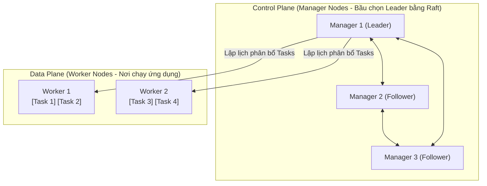
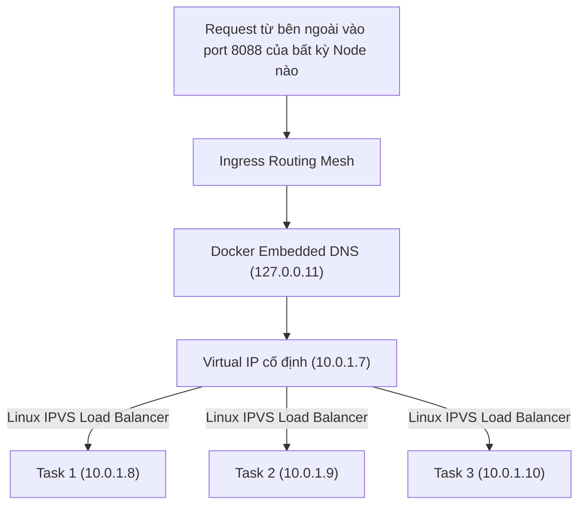

# 📘 SỔ TAY THỰC CHIẾN DOCKER SWARM: TỪ CƠ BẢN ĐẾN CHUẨN DEVOPS
> **Dự án áp dụng:** Hệ thống RBAC for Kong (Spring Boot, Postgres, Redis, Kong Gateway)  
> **Thời gian học & thực hành:** Lộ trình 3 ngày thực chiến  
> **Mục tiêu:** Nắm vững bản chất Container Orchestration, tự tin vận hành High Availability, Zero-Downtime Deployment và báo cáo ấn tượng với Mentor.

---

## MỤC LỤC
1. [Tư duy Cốt lõi: Docker Compose vs. Docker Swarm](#1-tư-duy-cốt-lõi-docker-compose-vs-docker-swarm)
2. [Kiến trúc & Các Khái niệm Trọng tâm](#2-kiến-trúc--các-khái-niệm-trọng-tâm)
3. [Mạng Phân tán & Cân bằng tải (Networking Deep Dive)](#3-mạng-phân-tán--cân-bằng-tải-networking-deep-dive)
4. [Vận hành Sẵn sàng cao (HA, Scaling, Zero-Downtime, Rollback)](#4-vận-hành-sẵn-sàng-cao-ha-scaling-zero-downtime-rollback)
5. [Bảo mật & Quản trị Cấu hình (Secrets & Configs)](#5-bảo-mật--quản-trị-cấu-hình-secrets--configs)
6. [Bảng Tra cứu Lệnh CLI Toàn tập (Cheatsheet)](#6-bảng-tra-cứu-lệnh-cli-toàn-tập-cheatsheet)
7. [File Mẫu Chuẩn Production (`docker-stack.yml`)](#7-file-mẫu-chuẩn-production-docker-stackyml)
8. [Kịch bản Trình bày Kiến trúc & Demo Kỹ thuật](#8-kịch-bản-trình-bày-kiến-trúc--demo-kỹ-thuật)

---

## 1. TƯ DUY CỐT LÕI: DOCKER COMPOSE VS. DOCKER SWARM

### 1.1. Bảng so sánh bản chất
| Tiêu chí | Docker Compose (`docker compose up`) | Docker Swarm (`docker stack deploy`) |
| :--- | :--- | :--- |
| **Phạm vi** | Chạy trên **1 máy chủ đơn lẻ (Single Host)** | Cụm phân tán trên **nhiều máy chủ (Cluster)** |
| **Tư duy quản trị** | Quản lý từng **Container độc lập** | Quản lý theo **Desired State (Trạng thái mong muốn)** |
| **Cơ chế chịu lỗi** | Không có (Container chết là hệ thống chết) | **Self-healing:** Tự động hồi sinh container mới bù đắp |
| **Cân bằng tải** | Không có sẵn (Cần tự cài Nginx/HAProxy) | Tích hợp sẵn **Routing Mesh (Linux IPVS) Round-Robin** |
| **Cập nhật code** | Phải stop container cũ $\rightarrow$ **Downtime** | **Zero-Downtime Rolling Update** (`order: start-first`) |
| **Bảo mật mật khẩu** | Plain-text trong file `.env` hoặc YAML | **Docker Secrets:** Mã hóa Raft, chỉ mount vào RAM |

### 1.2. Tư duy "Desired State" (Trạng thái mong muốn)
* Bạn không ra lệnh: *"Hãy chạy 1 container"*.
* Bạn khai báo: *"Tôi muốn service Backend luôn luôn có đúng 3 bản sao khỏe mạnh!"*.
* **Vòng lặp hòa giải (Reconciliation Loop):** Manager Node liên tục so sánh:
  $$\text{Actual State (Thực tế)} \longleftrightarrow \text{Desired State (Mong muốn)}$$
  Nếu một container bị kill hoặc lỗi OOM $\rightarrow$ Manager tự sinh ngay container mới để đưa Actual State về bằng Desired State.

---

## 2. KIẾN TRÚC & CÁC KHÁI NIỆM TRỌNG TÂM

### 2.1. Cấu trúc Cụm (Cluster)

* **Manager Node:** Tiếp nhận cấu hình, duy trì Desired State, lập lịch (scheduling) và quản lý đồng thuận Raft (Số Manager nên là số lẻ: 1, 3, 5).
* **Worker Node:** Nhận nhiệm vụ từ Manager và khởi chạy container.

### 2.2. Phân cấp Thực thi: Stack $\rightarrow$ Service $\rightarrow$ Task $\rightarrow$ Container
1. **Stack:** Toàn bộ ứng dụng (ví dụ: Stack `rbac-core`).
2. **Service:** Một thành phần logic (ví dụ: Service `postgres`, `web-demo`).
3. **Task:** Một vị trí/slot thực thi do Manager gán cho một Node (ví dụ `web-demo.1`, `web-demo.2`).
4. **Container:** Thực thể tiến trình Linux do Node chạy lên tương ứng với Task.

### 2.3. Quy tắc Vàng: Stateless vs. Stateful
* **Stateless Service (Backend Spring Boot, Web API):** Không lưu dữ liệu cục bộ $\rightarrow$ Cho phép scale thoải mái (`replicas: 3, 5, 10`).
* **Stateful Service (Postgres, Redis, Kafka):** Có lưu dữ liệu vào ổ đĩa $\rightarrow$ **Chỉ chạy 1 replica** và phải **ghim chặt** vào Manager node bằng `placement constraints` để tránh mất dữ liệu:
  ```yaml
  deploy:
    replicas: 1
    placement:
      constraints:
        - node.role == manager
  ```

---

## 3. MẠNG PHÂN TÁN & CÂN BẰNG TẢI (NETWORKING DEEP DIVE)



### 3.1. Overlay Network (Mạng phủ)
* Mạng ảo đóng gói qua VXLAN, kết nối tất cả các máy trong cụm lại như thể cắm chung một Switch nội bộ.
* Cấp dải IP riêng (ví dụ `10.0.1.0/24`).

### 3.2. Virtual IP (VIP) & Docker Embedded DNS (`127.0.0.11`)
* Mỗi Service được cấp một **Virtual IP (VIP) cố định** duy nhất.
* Khi ứng dụng gọi `http://postgres:5432`, DNS Server `127.0.0.11` trả về địa chỉ VIP này.
* **Ý nghĩa thực tế:** Khi container Postgres bị khởi động lại và đổi IP thật, Backend Spring Boot **không bị mất kết nối** vì VIP của service không đổi!

### 3.3. Ingress Routing Mesh
* Bạn mở cổng (`ports: 8088:80`), **tất cả các node trong cụm đều lắng nghe ở cổng 8088**.
* Gói tin vào bất kỳ node nào cũng được tự động chuyển hướng và **cân bằng tải xoay vòng (Round-Robin)** đến các container đang chạy.

---

## 4. VẬN HÀNH SẴN SÀNG CAO (HA, SCALING, ZERO-DOWNTIME, ROLLBACK)

### 4.1. Co giãn tức thì (Dynamic Scaling)
Không cần chỉnh sửa file YAML, điều chỉnh tải trực tiếp qua CLI:
```bash
docker service scale rbac-core_web-demo=6
```

### 4.2. Khắc phục sự cố tự động (Self-Healing)
* Khi container bị lỗi crash loop hoặc bị kill cưỡng bức:
* Swarm Manager phát hiện Task chuyển sang `Failed` $\rightarrow$ Tự động sinh Task mới thay thế trong 1-2 giây.

### 4.3. Cập nhật Không gián đoạn (Zero-Downtime Rolling Update)
Cấu hình chuẩn trong khối `deploy.update_config`:
```yaml
update_config:
  parallelism: 1          # Cập nhật lần lượt từng container một
  delay: 5s               # Chờ 5s giữa các lần cập nhật
  order: start-first      # QUAN TRỌNG: Bật container mới lên trước, pass healthcheck mới tắt bản cũ
  failure_action: rollback# Tự động lùi về bản cũ nếu bản mới lỗi
  monitor: 5s             # Theo dõi sức khỏe 5s trước khi chuyển sang container tiếp theo
rollback_config:
  parallelism: 1
  delay: 5s
  order: stop-first
```

---

## 5. BẢO MẬT & QUẢN TRỊ CẤU HÌNH (SECRETS & CONFIGS)

```
Docker Compose (CŨ):   POSTGRES_PASSWORD=Admin123  --> Lộ trong file git, docker inspect, log.
Docker Swarm (CHUẨN):  /run/secrets/db_password    --> Mã hóa trong Raft, chỉ nằm trong RAM ảo tmpfs.
```

### 5.1. Docker Secrets (Dành cho dữ liệu nhạy cảm)
* **Quy trình:**
  1. Tạo secret bên ngoài: `docker secret create db_password ./pass.txt`
  2. Khai báo vào service: `secrets: [db_password]`
  3. Postgres đọc từ file: `POSTGRES_PASSWORD_FILE: /run/secrets/db_password`
* **Đặc tính:** Lưu mã hóa tại Manager Node, truyền qua mTLS, mount vào bộ nhớ RAM ảo (`tmpfs`) của container $\rightarrow$ Không ghi xuống ổ đĩa, container tắt là mất.

### 5.2. Docker Configs (Dành cho file cấu hình)
* Dùng cho `redis.conf`, `nginx.conf`, file `.properties`...
* Cho phép thay đổi cấu hình ứng dụng **mà không cần build lại Docker Image**.

---

## 6. BẢNG TRA CỨU LỆNH CLI TOÀN TẬP (CHEATSHEET)

### Quản trị Cụm & Nodes
```bash
docker swarm init                        # Khởi tạo cụm (biến máy này thành Manager Leader)
docker node ls                           # Liệt kê danh sách các node trong cụm
docker swarm join-token worker           # Lấy mã token để máy khác gia nhập làm Worker
docker swarm leave --force               # Rời khỏi cụm / Hủy chế độ Swarm
```

### Quản trị Stack (Ứng dụng)
```bash
docker stack deploy -c docker-stack.yml rbac-core  # Deploy hoặc cập nhật toàn bộ stack
docker stack ls                                     # Xem danh sách các stack đang chạy
docker stack services rbac-core                     # Xem các service thuộc stack (Replicas)
docker stack ps rbac-core                           # Xem toàn bộ tasks và trạng thái các node
docker stack rm rbac-core                           # Xóa toàn bộ stack
```

### Quản trị Service & Vận hành
```bash
docker service ls                                   # Liệt kê tất cả các service
docker service ps <service_name>                    # Xem chi tiết từng instance của service
docker service logs -f <service_name>               # Xem log tập trung của tất cả bản sao
docker service scale <service_name>=5               # Scale số lượng container tức thì
docker service update --image <image:tag> <service> # Cập nhật image (Rolling Update)
docker service rollback <service_name>              # Hoàn tác về phiên bản trước đó
```

### Quản trị Secrets & Configs
```bash
docker secret create <name> <file_path>             # Tạo secret mới
docker secret ls                                    # Liệt kê danh sách secret
docker config create <name> <file_path>             # Tạo config mới
docker config ls                                    # Liệt kê danh sách config
```

---

## 7. FILE MẪU CHUẨN PRODUCTION (`docker-stack.yml`)

Dưới đây là file cấu hình hoàn chỉnh đã được kiểm chứng hoạt động 100% trên máy:

```yaml
version: '3.8'

services:
  # 1. Cơ sở dữ liệu Postgres (Bảo mật: Đọc mật khẩu từ Docker Secret)
  postgres:
    image: postgres:17
    environment:
      POSTGRES_DB: rbac_management
      POSTGRES_USER: postgres
      POSTGRES_PASSWORD_FILE: /run/secrets/db_password
      TZ: Asia/Ho_Chi_Minh
    ports:
      - "5432:5432"
    volumes:
      - postgres_data:/var/lib/postgresql/data
    networks:
      - rbac_net
    secrets:
      - db_password
    healthcheck:
      test: ["CMD-SHELL", "pg_isready -U postgres"]
      interval: 10s
      timeout: 5s
      retries: 5
    deploy:
      replicas: 1
      placement:
        constraints:
          - node.role == manager
      restart_policy:
        condition: on-failure
        delay: 5s
        max_attempts: 3
      resources:
        limits:
          cpus: '1.0'
          memory: 512M

  # 2. Redis Cache (Quản trị: Cấu hình qua Docker Config)
  redis:
    image: redis:7-alpine
    command: redis-server /usr/local/etc/redis/redis.conf --requirepass redis123
    ports:
      - "6379:6379"
    volumes:
      - redis_data:/data
    networks:
      - rbac_net
    configs:
      - source: redis_config
        target: /usr/local/etc/redis/redis.conf
    healthcheck:
      test: ["CMD", "redis-cli", "-a", "redis123", "ping"]
      interval: 10s
      timeout: 5s
      retries: 5
    deploy:
      replicas: 1
      restart_policy:
        condition: on-failure
        delay: 5s
        max_attempts: 3
      resources:
        limits:
          cpus: '0.5'
          memory: 256M

  # 3. Web Service mẫu (Stateless: Cân bằng tải, Rolling Update & Rollback)
  web-demo:
    image: traefik/whoami:latest
    ports:
      - "8088:80"
    networks:
      - rbac_net
    deploy:
      replicas: 3
      restart_policy:
        condition: on-failure
        delay: 3s
        max_attempts: 3
      resources:
        limits:
          cpus: '0.2'
          memory: 64M
      update_config:
        parallelism: 1
        delay: 5s
        order: start-first
        failure_action: rollback
        monitor: 5s
      rollback_config:
        parallelism: 1
        delay: 5s
        order: stop-first

  # 4. Giao diện trực quan Swarm Visualizer
  visualizer:
    image: dockersamples/visualizer:latest
    ports:
      - "8888:8080"
    volumes:
      - /var/run/docker.sock:/var/run/docker.sock
    networks:
      - rbac_net
    deploy:
      replicas: 1
      placement:
        constraints:
          - node.role == manager

volumes:
  postgres_data:
  redis_data:

networks:
  rbac_net:
    driver: overlay

secrets:
  db_password:
    external: true

configs:
  redis_config:
    external: true
```

---

## 8. KỊCH BẢN TRÌNH BÀY KIẾN TRÚC & DEMO KỸ THUẬT

### 🎙️ Tổng quan kiến trúc & giá trị kỹ thuật:
> *"Trong giải pháp hạ tầng phân tán này, chúng tôi áp dụng **Docker Swarm** để giải quyết các bài toán vận hành High Availability (HA) và Zero-Downtime Deployment cho hệ thống API Gateway:*
> 1. *Quản trị cụm phân tán theo cơ chế **Desired State** thông qua Raft Consensus trên Manager Nodes.*
> 2. *Tận dụng **Overlay Network** và **Ingress Routing Mesh** để tự động cân bằng tải Round-Robin giữa các container mà không cần phụ thuộc vào external reverse proxy.*
> 3. *Cấu hình chiến lược `order: start-first` nhằm đạt **Zero-Downtime Deployment** khi cập nhật service, kết hợp cơ chế **Self-Healing** tự động phục hồi container khi gặp sự cố.*
> 4. *Bảo mật thông tin nhạy cảm theo chuẩn Enterprise với **Docker Secrets** và **Docker Configs**, loại bỏ hoàn toàn mật khẩu plaintext trong môi trường Production."*

### 🖥️ Quy trình Demo kỹ thuật trực quan:
1. **Giao diện cụm trực quan Swarm Visualizer (`http://localhost:8888`):** Quan sát trực quan cấu trúc node và vị trí các container trong cụm.
2. **Demo Scale:** Gõ `docker service scale rbac-core_web-demo=6` $\rightarrow$ Thấy 6 ô container bật sáng ngay trên màn hình.
3. **Demo Self-healing:** Gõ `docker kill <id>` $\rightarrow$ Chứng minh Swarm tự bật container mới thay thế sau 2 giây.

### ❓ Hai câu hỏi phản biện then chốt:
* **Hỏi:** *"Tại sao không dùng Kubernetes luôn?"*  
  **Đáp:** *"Kubernetes mạnh mẽ nhưng chi phí hạ tầng và độ phức tạp vận hành rất cao. Với hệ thống quy mô dưới 20 máy chủ, Docker Swarm là lựa chọn tối ưu vì siêu nhẹ, tích hợp sẵn trong Docker, tái sử dụng cú pháp Compose và đáp ứng hoàn hảo 90% nhu cầu High Availability."*
* **Hỏi:** *"Tại sao không scale container Database lên 3 bản?"*  
  **Đáp:** *"Vì Database là Stateful Service lưu trữ dữ liệu vào đĩa cứng. Nếu scale mà không có giải pháp sao lưu Master-Slave hoặc chia sẻ storage phân tán (NFS/Ceph), các container sẽ ghi đè làm hỏng dữ liệu. Do đó em ghim Postgres 1 replica duy nhất tại Manager node."*
