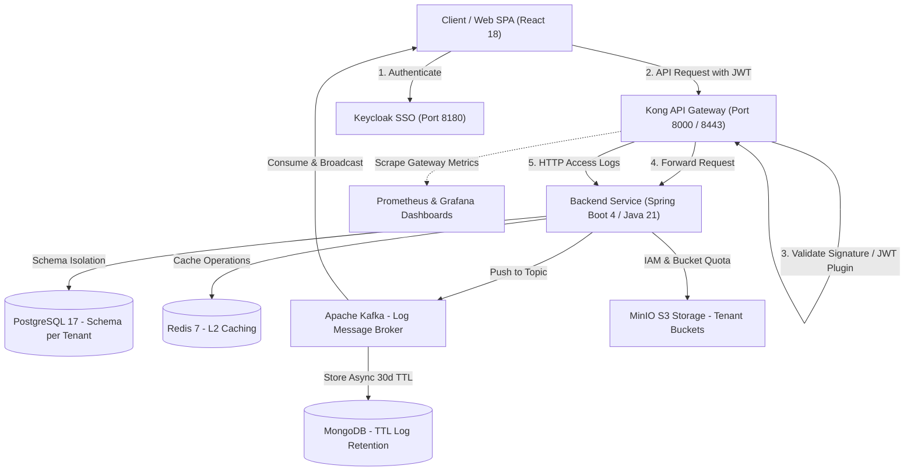

# 🚀 Enterprise API Gateway Management & Observability Platform

[](https://openjdk.org/)
[](https://spring.io/projects/spring-boot)
[](https://konghq.com/)
[](https://www.keycloak.org/)
[](https://kafka.apache.org/)
[](https://react.dev/)
[](https://docs.docker.com/engine/swarm/)
[](LICENSE)

An Enterprise-grade, Multi-Tenant API Gateway Orchestration & Real-time Observability Platform. The system enables organizations to dynamically manage multiple Kong Gateway clusters, enforce fine-grained Role-Based Access Control (RBAC), isolate tenant data, stream access logs in real-time, and automate S3 object storage provisioning.

---

## 🏛️ System Architecture



---

## ✨ Key Architectural Highlights

### 1. 🛡️ Perimeter Security & Gateway-Trust Architecture
* **Centralized Perimeter Verification:** Kong Gateway verifies cryptographic JWT signatures at the perimeter boundary, relieving internal backend services from repetitive JWKS network lookups.
* **KongJwtTrustFilter:** Decodes token claims and authorities into Spring Security's `SecurityContext` with support for optional internal shared secret verification (`X-Gateway-Internal-Key`).
* **Automated JWT Provisioning:** Dynamically provisions Keycloak OIDC clients, Kong consumers, and JWT plugins when new tenant projects are created.

### 2. 🏢 Multi-Tenant Isolation (Schema-per-Tenant)
* Complete data isolation using **PostgreSQL schemas** (`SET search_path TO "<tenant>", public`).
* Automatic database migration lifecycle via **Liquibase** (`db.changelog-tenant.yaml`) executed on tenant provisioning.
* Dynamic resolution of current tenant context via URL path and JWT tenant claims.

### 3. 🌐 Dynamic Multi-Kong Gateway Orchestration
* **Multi-Cluster Support:** Connects and orchestrates multiple independent Kong Gateway clusters from a single control plane.
* **Dynamic RestClient Factory:** Thread-safe, cached HTTP clients communicating with various Kong Admin APIs.
* **Configuration Drift Detection:** Background scheduled reconciler compares database state against live Kong instances to detect out-of-sync configurations.

### 4. 📊 Real-Time Observability Pipeline
* **High-Throughput Log Streaming:** Access logs captured via Kong's `http-log` plugin, processed through **Apache Kafka**, and streamed directly to the frontend dashboard over **WebSocket (STOMP)**.
* **Dual-Tier Storage Strategy:**
  * **Short-Term Live Traffic:** Streamed via WebSocket for immediate real-time monitoring.
  * **Long-Term Audit & Storage:** Asynchronously persisted into **MongoDB** with an automatic **30-day TTL Index** to optimize disk storage.
* **Automated Audit Logging via Spring AOP:** Intercepts sensitive mutation operations (`@Around`) to record actor identity, client IP, action type, and JSON payload diffs.

### 5. 🪣 Automated S3 Object Storage Management
* Automatic MinIO Bucket creation, storage quota enforcement, and fine-grained S3 IAM policies per project.
* Integrated web-based **File Explorer** supporting presigned upload/download URLs, folder permission controls, and bulk file operations.

### 6. 🐳 Container Orchestration & High Availability
* Production-ready deployment stack supporting both **Docker Compose** and **Docker Swarm Mode**.
* Overlay networking, Ingress Routing Mesh, self-healing auto-recovery, and Zero-Downtime rolling updates.

---

## 🗂️ Project Structure

```text
├── frontend/                     # React 18 + Vite SPA Dashboard
│   ├── src/
│   │   ├── components/           # Reusable UI components & Kong widgets
│   │   ├── context/              # AuthContext, KongContext
│   │   ├── pages/                # Projects, Kong, Observability, Storage
│   │   └── services/             # Axios API client & WebSocket services
│   └── package.json
├── infrastructure/               # Infrastructure configs
│   ├── grafana/                  # Grafana dashboards & provisioning
│   ├── keycloak/themes/modern/   # Custom Keycloak Glassmorphism Theme
│   └── prometheus/               # Prometheus metrics scraper config
├── scripts/                      # Operational & bootstrapping automation
│   ├── mock-servers.js           # Mock upstream services (Port 8081 & 8082)
│   ├── setup-all.ps1 / .sh       # One-shot unified bootstrap (Windows & Linux)
│   ├── setup-keycloak.ps1 / .sh  # Keycloak realm, client & admin bootstrap
│   └── setup-kong.ps1 / .sh      # Kong service & proxy route bootstrap
├── src/                          # Spring Boot 4 Backend Service
│   ├── main/java/com/vcc/template/
│   │   ├── access/               # RBAC security models & evaluators
│   │   ├── common/               # Multi-tenancy, filters, S3, cache config
│   │   ├── kong/                 # Gateway client, services, routes, upstreams
│   │   ├── observability/        # Kafka consumer, MongoDB logs, audit AOP
│   │   ├── project/              # Project lifecycle & tenant provisioning
│   │   └── storage/              # MinIO S3 integration & file explorer
│   └── main/resources/           # Configuration & Liquibase migrations
├── docker-compose.yml            # Complete local environment stack
├── docker-stack-full.yml         # Production-ready Docker Swarm stack
├── DOCKER_SWARM_HANDBOOK.md      # Comprehensive Docker Swarm technical guide
└── pom.xml                       # Maven build configuration
```

---

## 🚀 Quick Start Guide

### Prerequisites
* **Docker** & **Docker Compose** installed on your machine.
* *(Optional for manual local dev)*: **Java 21+** & **Node.js 18+**.

---

### Option A: All-in-One Instant Docker Deployment (Recommended)
You can launch the **entire platform** (Database, Cache, Message Broker, Storage, Keycloak, Kong, Backend, and Frontend) with a single command:

```bash
# 1. Build and run all services in the background
docker compose up -d --build

# 2. Run automated one-shot initialization (Keycloak Realm & Kong Routes)
# On Windows (PowerShell):
./scripts/setup-all.ps1

# On Linux / macOS (Bash):
chmod +x scripts/*.sh
./scripts/setup-all.sh
```

Once started, access the platform immediately:
* **Frontend Web Dashboard:** `http://localhost:5173` *(Log in with `admin` / `admin123`)*
* **Backend Swagger API Docs:** `http://localhost:8080/swagger`
* **Kong API Gateway Proxy:** `http://localhost:8000`
* **Kong Admin API:** `http://localhost:8001`
* **Keycloak Admin Console:** `http://localhost:8180` *(admin / admin)*
* **MinIO Storage Console:** `http://localhost:9001` *(minioadmin / minioadmin)*
* **Grafana Dashboards:** `http://localhost:3000` *(admin / admin)*

---

### Option B: Local Development Mode (Run Backend & Frontend directly)
If you prefer developing on your host machine:

```bash
# 1. Spin up only the middleware infrastructure
docker compose up -d postgres redis keycloak kong minio kafka zookeeper mongodb prometheus grafana

# 2. Run initialization scripts
./scripts/setup-keycloak.ps1
$env:BACKEND_URL="http://host.docker.internal:8080"; ./scripts/setup-kong.ps1

# 3. Run Spring Boot Backend
./mvnw clean spring-boot:run

# 4. Run React Frontend (in another terminal)
cd frontend
npm install
npm run dev
```

---

## 🔒 Security & RBAC Matrix

| Role | Project Management | Kong Config (Services/Routes) | Storage (Read/Download) | Storage (Upload/Delete) | Live Logs & Audit |
| :--- | :---: | :---: | :---: | :---: | :---: |
| **SYSTEM_ADMIN** | Full Access | Full Access | Full Access | Full Access | Full Access |
| **PROJECT_ADMIN**| Manage Project | Create / Edit / Delete | Full Access | Full Access | View Logs |
| **MAINTAINER**   | View Details | Create / Edit (Approval) | Full Access | Upload / Manage | View Logs |
| **DEVELOPER**    | View Details | Read-only | Read / Download | Forbidden | View Logs |
| **VIEWER**       | Read-only | Read-only | Read / Download | Forbidden | Forbidden |

---

## 🧪 Testing Upstream Load Balancing & Healthchecks
To test Kong's Round-Robin load balancing and target healthcheck mechanism:

```bash
node scripts/mock-servers.js
```
This spins up two test upstream HTTP servers on ports `8081` and `8082`. Traffic sent through Kong will automatically alternate between instances and reflect real-time status on the dashboard.

---

## 📄 License
This project is licensed under the MIT License - see the [LICENSE](LICENSE) file for details.
